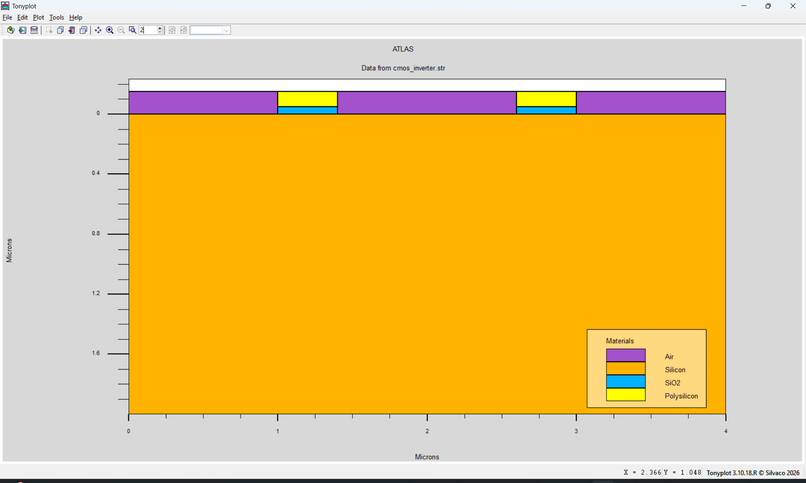
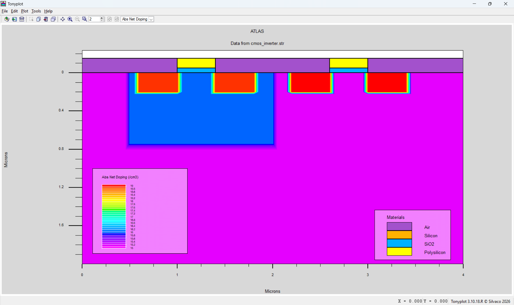

# CMOS-Inverter-Design-Using-Silvaco-TCAD
CMOS inverter design and device simulation using Silvaco TCAD
# CMOS Inverter Design and Simulation Using Silvaco TCAD

## Project Overview

This project focuses on the design, structure development, and device-level simulation of a CMOS inverter using **Silvaco TCAD**.

The project uses the ATLAS device simulator to study semiconductor device structures and electrical characteristics of CMOS-related structures. TonyPlot is used to visualize the simulation results.

## Objectives

- Design a CMOS inverter structure using Silvaco TCAD.
- Define semiconductor regions, materials, electrodes, and doping profiles.
- Develop the device structure using TCAD commands.
- Perform device-level electrical simulations.
- Analyze and visualize simulation characteristics using TonyPlot.

## Tools and Technologies

| Tool | Purpose |
|---|---|
| Silvaco DeckBuild | TCAD simulation environment |
| Silvaco ATLAS | Semiconductor device simulation |
| Silvaco TonyPlot | Structure and graph visualization |

## Repository Structure

```text
CMOS-Inverter-Design-Using-Silvaco-TCAD/
│
├── TCAD/
│   └── cmos_inverter.in
│
├── Results/
│   ├── Simulation log files
│   └── Structure files (.str)
│
├── Screenshots/
│   └── Device_Structure/
│       └── Simulation screenshots
│
├── Documentation/
│
└── README.md
```

## Simulation Workflow

1. Define the simulation mesh.
2. Specify semiconductor material regions.
3. Define doping profiles.
4. Configure electrodes and device terminals.
5. Define semiconductor physical models.
6. Perform electrical device simulations.
7. Save simulation data and structure files.
8. Visualize the results using TonyPlot.

## Simulation Results

The repository includes simulation output files and screenshots showing:

- CMOS material structure.
- Semiconductor doping profiles.
- Device structure visualization.
- Drain current versus gate voltage characteristics.
- Drain voltage versus gate voltage characteristics.

## Screenshots

### CMOS Material Structure



### Doping Profile



## How to Run

1. Install and configure Silvaco TCAD with a valid license.
2. Open Silvaco DeckBuild.
3. Load `TCAD/cmos_inverter.in`.
4. Execute the simulation.
5. View the generated structure and electrical characteristics using TonyPlot.

**Note:** Simulation compatibility depends on the Silvaco TCAD version and configuration.

## Conclusion

This project provides practical experience in semiconductor device structure development and TCAD-based electrical simulation. It demonstrates the use of Silvaco tools for semiconductor device modeling, simulation, and result visualization.

## Author

**Hasan**

Electronics and Communication Engineering

GitHub: [Hasan-vlsi](https://github.com/Hasan-vlsi)

---

*This project is developed for academic learning and practical exploration of semiconductor device simulation using Silvaco TCAD.*
